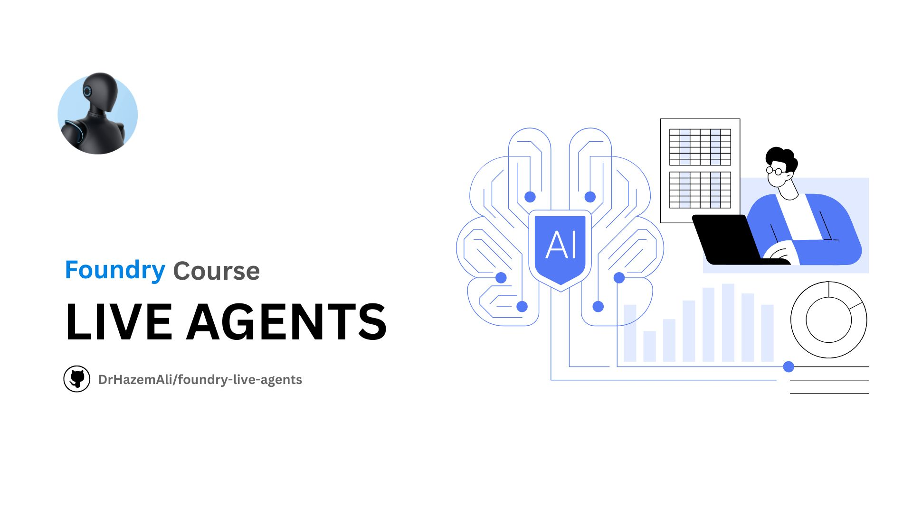

# Foundry Live Agents 🎙️
A comprehensive learning repository and sample collection for building enterprise-scale voice agents using Azure Speech Voice Live API, featuring 600+ voices, multi-language support, and production-ready agent scenarios.



> **Enterprise-Scale Voice Agent Tutorial & Interactive Samples**  
> Build production-ready voice agents with Azure Speech Voice Live API

[](https://opensource.org/licenses/MIT)
[](https://learn.microsoft.com/azure/ai-services/speech-service/voice-live)
[](https://ignite.microsoft.com/)

> **⚠️ Important Notice: Community-Maintained Repository**  
> 
> This repository is **independently created and maintained by the community** and is **not affiliated with, endorsed by, or supported by Microsoft Corporation**. 
>
> **Why This Matters:**
> - **Independent Development**: All code, documentation, and samples are developed independently without official Microsoft involvement
> - **Educational Purpose**: This is an educational resource to help developers learn Azure Speech Voice Live API
> - **No Official Support**: Microsoft does not provide support for this repository - use official Azure channels for API support
> - **Community-Driven**: Contributions, improvements, and support come from community members
> - **Unofficial Examples**: While following Azure documentation, implementations here are not official Microsoft samples
>
> **Official Resources:**
> - 📚 [Official Azure Speech Voice Live Documentation](https://learn.microsoft.com/azure/ai-services/speech-service/voice-live)
> - 🔧 [Official Azure Speech SDK](https://github.com/Azure-Samples/cognitive-services-speech-sdk)
> - 💬 [Official Microsoft Q&A Support](https://learn.microsoft.com/answers/tags/133/azure-speech)
> - 🎯 [Official Azure Samples](https://github.com/Azure-Samples)
>
> For official Microsoft support, please use [Azure Support Portal](https://azure.microsoft.com/support/options/).

## 🌟 What You'll Learn

This repository provides a **complete learning path** for building enterprise-scale voice agents using Azure Speech Voice Live API. Following the latest documentation from MS Ignite 2025, you'll master:

- **Real-time voice interactions** with 600+ voices across 150+ languages
- **Advanced VAD** (Voice Activity Detection) with Azure Semantic VAD Multilingual
- **Function calling & VoiceRAG** patterns for intelligent context-aware agents
- **Avatar integration** with WebRTC video streaming
- **10+ production-ready agent scenarios** from customer support to healthcare
- **Multi-platform implementation** in TypeScript, Python, Go, C#, and SwiftUI

## 🚀 Quick Start

### Interactive Playground

Experience Voice Live immediately with our interactive web playground:

```bash
cd playground
npm install
npm run dev
```

Open http://localhost:5173 to explore:
- 600+ voice options with real-time preview
- Multiple language configurations
- VAD and audio enhancement settings
- Pre-configured agent scenarios

### Your First Voice Agent (TypeScript)

```bash
cd samples/typescript/basic-voice-agent
npm install
cp .env.example .env  # Add your Azure credentials
npm start
```

## 📚 Learning Path

Follow our structured course modules:

| Module | Topic | Duration |
|--------|-------|----------|
| [01 - Foundations](docs/01-foundations.md) | Voice Live Overview & Architecture | 30 min |
| [02 - Getting Started](docs/02-getting-started.md) | Azure Setup & Authentication | 45 min |
| [03 - Voices & Languages](docs/03-voices-languages.md) | Voice Selection & Customization | 60 min |
| [Voice Catalog](docs/voice-catalog.md) | Complete 600+ Voice Reference | - |
| [04 - Configuration](docs/04-configuration.md) | Session Config & VAD Mastery | 90 min |
| [05 - Agent Scenarios](docs/05-agent-scenarios.md) | Building Production Agents | 120 min |
| [06 - Advanced Features](docs/06-advanced-features.md) | Functions, RAG & Avatars | 90 min |
| [07 - Multi-Language](docs/07-multi-language.md) | Global Agent Development | 60 min |
| [08 - Production Deployment](docs/08-production-deployment.md) | Kubernetes, Terraform & Monitoring | 90 min |
| [09 - API Reference](docs/09-api-reference.md) | Complete API Documentation | - |
| [API Changelog](docs/api-changelog.md) | Version History & Migration | - |
| [10 - Troubleshooting & FAQ](docs/10-troubleshooting.md) | Common Issues & Solutions | - |

**Total Learning Time:** ~10 hours 

## 🎭 Pre-Built Agent Scenarios

Deploy production-ready voice agents for common use cases:

| Agent | Description | Languages | Functions |
|-------|-------------|-----------|----------|
| [Customer Support](agents/customer-support/) | Multi-channel support with sentiment detection | 10 | Ticket, CRM, KB search |
| [Travel Booking](agents/travel-booking/) | Destination recommendations & itineraries | 6 | Search, book, modify |
| [Healthcare Triage](agents/healthcare-triage/) | HIPAA-aware medical assistance | 5 | Symptom check, schedule |
| [Technical Support](agents/technical-support/) | IT troubleshooting & knowledge base | 7 | Diagnostics, KB, tickets |
| [Sales Assistant](agents/sales-assistant/) | Product recommendations & closing | 8 | Product search, quotes |
| [Appointment Scheduler](agents/appointment-scheduler/) | Calendar management & reminders | 6 | Availability, booking |
| [Education Tutor](agents/education-tutor/) | Socratic teaching & practice | 6 | Practice problems, progress |
| [E-Commerce Support](agents/ecommerce/) | Shopping assistance & order tracking | 6 | Product search, returns |
| [Financial Advisor](agents/financial-advisor/) | Investment guidance & portfolio analysis | 6 | Portfolio, recommendations |
| [HR Assistant](agents/hr-assistant/) | Recruitment & employee services | 6 | Screening, benefits, PTO |
| [Legal Assistant](agents/legal-assistant/) | Contract review & legal research | 6 | Contract analysis, case law |

Each agent includes complete configuration files, optimized prompts, example conversations, and integration code.

## 💻 Sample Implementations

### Languages & Frameworks

Explore Voice Live across multiple platforms:

```
samples/
├── typescript/          # Node.js & Browser samples
├── python/              # Python with asyncio
├── go/                  # Go with goroutines
├── csharp/              # .NET 8.0+
└── swift/               # SwiftUI for iOS/macOS
```

### Sample Types (Available in Each Language)

1. **basic-voice-agent** - Simple WebSocket connection with audio streaming
2. **multi-language-voice-agent** - 10+ language support with auto-detection
3. **voice-with-avatar** - WebRTC avatar video streaming
4. **voice-with-functions** - Tool/function calling integration
5. **voicerag-pattern** - Knowledge base integration with Azure AI Search
6. **voice-with-customization** - Custom speech models & phrase lists
7. **advanced-vad-configuration** - Fine-tuned VAD for all scenarios
8. **agent-service-integration** - Microsoft Foundry Agent Service

## 🎨 Voice Catalog

Explore **600+ voices** across **150+ languages**:

- **OpenAI Voices** (10): alloy, ash, ballad, coral, echo, sage, shimmer, verse, marin, cedar
- **Azure Standard Voices** (500+): 150+ locales with neural quality
- **Azure HD Voices** (50+): High-definition voices in select regions
- **Azure Personal Voices** (3): DragonLatestNeural, PhoenixLatestNeural, PhoenixV2Neural
- **Custom Voices**: Professional & Personal voice cloning

📖 **[Complete Voice Catalog →](docs/voice-catalog.md)**

## 🎯 Key Features

### 🗣️ Voice Activity Detection (VAD)

- **Server VAD** - Simple volume-based detection
- **OpenAI Semantic VAD** - Model-based with eagerness control
- **Azure Semantic VAD** - Semantic meaning detection
- **Azure Semantic VAD Multilingual** - 10+ language support

### 🎧 Audio Enhancements

- **Deep Noise Suppression** - Background noise removal
- **Echo Cancellation** - Server-side echo elimination
- **Filler Word Removal** - Reduces false barge-ins
- **End-of-Utterance Detection** - Smart turn-ending

### 🤖 AI Models

- **Voice Live Pro**: gpt-realtime, gpt-4o, gpt-4.1, gpt-5
- **Voice Live Basic**: gpt-realtime-mini, gpt-4o-mini, gpt-4.1-mini, gpt-5-mini
- **Voice Live Lite**: gpt-5-nano, phi4-mm-realtime, phi4-mini

### 🌍 Multi-Language Support

Priority languages with full samples:
- English (en-US, en-GB, en-AU)
- Spanish (es-ES, es-MX)
- French (fr-FR, fr-CA)
- German (de-DE)
- Italian (it-IT)
- Japanese (ja-JP)
- Portuguese (pt-BR, pt-PT)
- Chinese (zh-CN, zh-TW)
- Korean (ko-KR)
- Hindi (hi-IN)

Plus 140+ additional locales with configuration templates.

## ⚙️ Configuration Library

Pre-built configurations for rapid development:

```
config/
├── voice-configs/       # 600+ voice configurations
├── language-configs/    # 20+ language templates
├── vad-configs/         # Pre-tuned VAD settings
├── model-configs/       # Model-specific parameters
├── agent-configs/       # Complete agent setups
└── audio-configs/       # Format & quality profiles
```

## 🛠️ Prerequisites

- **Azure Subscription** with Speech Services or Microsoft Foundry resource
- **Supported Region** with Voice Live availability
- **Authentication**: Azure Entra ID (recommended) or API Key
- **Development Environment**: Node.js 18+, Python 3.10+, Go 1.21+, .NET 8.0+, or Xcode 15+

## 📦 Installation

### Clone Repository

```bash
git clone https://github.com/DrHazemAli/foundry-live-agents.git
cd foundry-live-agents
```

### Setup Azure Resources

```bash
# Follow the getting started guide
open docs/02-getting-started.md
```

### Configure Environment

```bash
cp .env.example .env
# Edit .env with your Azure credentials
```

## 🏗️ Repository Structure

```
foundry-live-agents/
├── agents/                      # 10+ pre-built agent scenarios
├── config/                      # Configuration templates
├── docs/                        # Learning path documentation
├── playground/                  # Interactive Vite UI
├── samples/
│   ├── typescript/             # TypeScript samples (8 types)
│   ├── python/                 # Python samples (8 types)
│   ├── go/                     # Go samples (8 types)
│   ├── csharp/                 # C# samples (8 types)
│   └── swift/                  # SwiftUI samples (8 types)
├── utilities/                   # Shared code & helpers
├── .env.example                # Environment template
├── LICENSE                     # MIT License
└── README.md                   # This file
```

## 🚢 Deployment

Deploy to Azure:

- **Azure Container Apps** - Containerized agents
- **Azure Web Apps** - Managed web hosting
- **Azure Static Web Apps** - Playground deployment
- **Azure Kubernetes Service** - Large-scale orchestration

See [Production Deployment Guide](docs/09-production.md) for details.

## 📖 Documentation

- **[Voice Catalog](docs/voice-catalog.md)** - Complete 600+ voice reference
- **[API Reference](docs/09-api-reference.md)** - Full API documentation  
- **[API Changelog](docs/api-changelog.md)** - Version history & migrations
- **[Production Deployment](docs/08-production-deployment.md)** - Kubernetes & best practices
- **[Troubleshooting & FAQ](docs/10-troubleshooting.md)** - Common issues & solutions

## 🤝 Contributing

Contributions welcome! See our [Contributing Guide](CONTRIBUTING.md) for details.

## 📄 License

This project is licensed under the MIT License - see the [LICENSE](LICENSE) file for details.

## 🔗 Resources

### Official Microsoft Resources
- **[Azure Speech Voice Live Documentation](https://learn.microsoft.com/azure/ai-services/speech-service/voice-live)** - Official API documentation
- **[Official Azure Speech SDK](https://github.com/Azure-Samples/cognitive-services-speech-sdk)** - Microsoft's official SDK repository
- **[MS Ignite 2025 Announcements](https://ignite.microsoft.com/)** - Latest Azure announcements
- **[Azure Speech Service](https://azure.microsoft.com/services/cognitive-services/speech-services/)** - Service overview
- **[Microsoft Foundry](https://learn.microsoft.com/azure/ai-foundry/)** - AI Foundry documentation
- **[Azure Q&A](https://learn.microsoft.com/answers/tags/133/azure-speech)** - Official Microsoft Q&A support

### This Community Repository
- **[Repository Home](https://github.com/DrHazemAli/foundry-live-agents)** - Main repository
- **[Issues](https://github.com/DrHazemAli/foundry-live-agents/issues)** - Bug reports and feature requests
- **[Discussions](https://github.com/DrHazemAli/foundry-live-agents/discussions)** - Community discussions and questions
- **[Contributing Guide](CONTRIBUTING.md)** - How to contribute

## 💬 Support

### For Azure Voice Live API Issues
- **Azure Support Portal**: [Get Official Support](https://azure.microsoft.com/support/options/)
- **Microsoft Q&A**: [Ask Questions](https://learn.microsoft.com/answers/tags/133/azure-speech)
- **Azure Documentation**: [Official Docs](https://learn.microsoft.com/azure/ai-services/speech-service/voice-live)

### For This Repository
- **Bug Reports**: [GitHub Issues](https://github.com/DrHazemAli/foundry-live-agents/issues)
- **Feature Requests**: [GitHub Issues](https://github.com/DrHazemAli/foundry-live-agents/issues)
- **Community Help**: [GitHub Discussions](https://github.com/DrHazemAli/foundry-live-agents/discussions)

**Note**: For production Azure issues or billing questions, always contact [official Azure Support](https://azure.microsoft.com/support/options/).

## 🌟 Star History

If you find this repository helpful, please consider giving it a star! ⭐

---

**Built with ❤️ by the community for the community**

© 2025 [Hazem Ali](https://github.com/DrHazemAli) • Licensed under [MIT License](LICENSE)

*This is an independent, community-maintained educational project. Not affiliated with Microsoft Corporation.*
