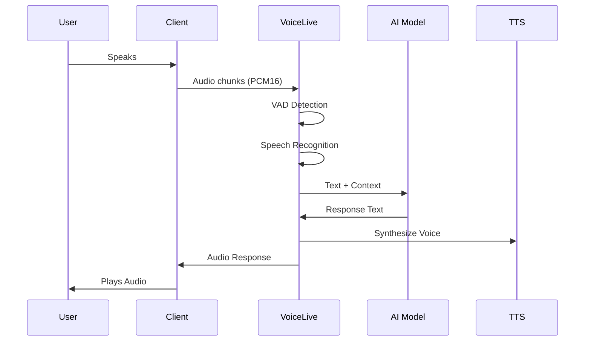

# Module 01: Foundations

> **Duration:** 30 minutes  
> **Level:** Beginner  
> **Prerequisites:** Basic understanding of APIs and real-time communication

## Learning Objectives

By the end of this module, you will:

- Understand what Azure Speech Voice Live API is and its core capabilities
- Learn the architecture and key components of Voice Live
- Discover how Voice Live differs from traditional speech-to-text → LLM → text-to-speech pipelines
- Identify ideal use cases for Voice Live agents

## What is Azure Speech Voice Live?

Azure Speech Voice Live is a **fully managed, end-to-end solution** for creating low-latency, high-quality speech-to-speech voice agents. Announced at MS Ignite 2025, it consolidates:

- **Speech Recognition** (speech-to-text)
- **Generative AI** (large language models)
- **Text-to-Speech** (neural voice synthesis)

into a **single unified WebSocket interface**.

### The Traditional Approach (Complex)

```
User Speaks
    ↓
[Speech-to-Text API]  ← You manage connection
    ↓
"Hello, I need help"
    ↓
[Azure OpenAI / GPT]  ← You manage orchestration
    ↓
"How can I assist you?"
    ↓
[Text-to-Speech API]  ← You manage timing
    ↓
Audio Response
```

**Challenges:**
- Manual orchestration required
- Higher latency (3 separate API calls)
- Complex error handling
- Difficult to implement interruptions
- No built-in Voice Activity Detection

### The Voice Live Approach (Simple)

```
User Speaks
    ↓
    ↓  ← Single WebSocket Connection
    ↓
[Voice Live API]
  • Auto speech recognition
  • AI processing
  • Voice synthesis
  • VAD & barge-in
  • Audio enhancements
    ↓
    ↓
    ↓
Audio Response
```

**Benefits:**
- Single WebSocket connection
- Ultra-low latency (< 1 second typical)
- Built-in VAD and interruption handling
- Automatic audio enhancement
- Simplified development

## Core Architecture

### WebSocket-Based Real-Time Communication

Voice Live uses **WebSockets** for bidirectional streaming:

```
┌─────────────┐                           ┌──────────────────┐
│   Client    │◄──── WebSocket ────────►│   Voice Live    │
│ Application │                           │      API         │
└─────────────┘                           └──────────────────┘
      ▲ │                                        │ │
      │ │                                        │ │
      │ └─ Audio (base64-encoded PCM16)        │ │
      │    Events (JSON)                        │ │
      │                                          │ │
      └────── Audio Responses ◄─────────────────┘ │
              Transcripts                          │
              Events (JSON) ◄─────────────────────┘
```

### Event-Driven Model

All interactions are **event-based**:

**Client → Server Events:**
- `session.update` - Configure session
- `input_audio_buffer.append` - Send audio
- `input_audio_buffer.commit` - Process audio
- `response.create` - Request response
- `conversation.item.create` - Add messages

**Server → Client Events:**
- `session.created` - Session ready
- `response.audio.delta` - Streaming audio
- `response.text.delta` - Streaming text
- `input_audio_buffer.speech_started` - VAD detected speech
- `error` - Error occurred

## Key Components

### 1. Voice Activity Detection (VAD)

Automatically detects when users start and stop speaking:

| VAD Type | Description | Best For |
|----------|-------------|----------|
| **Server VAD** | Volume-based | Simple scenarios |
| **OpenAI Semantic VAD** | Model-based | gpt-realtime models |
| **Azure Semantic VAD** | Semantic meaning | Robust detection |
| **Azure Semantic VAD Multilingual** | 10+ languages | Global applications |

### 2. Audio Enhancement

Built-in audio processing:

- **Deep Noise Suppression** - Removes background noise
- **Echo Cancellation** - Eliminates audio feedback
- **Filler Word Removal** - Reduces false interruptions
- **End-of-Utterance Detection** - Smart turn-ending

### 3. Voice Options

600+ voices across 150+ languages:

- **OpenAI Voices** (10) - Natural, expressive
- **Azure Standard Voices** (500+) - Wide language support
- **Azure HD Voices** (50+) - High-definition quality
- **Azure Personal Voices** - Voice cloning
- **Custom Voices** - Professional voice creation

### 4. AI Models

Multiple model tiers:

| Tier | Models | Use Case |
|------|--------|----------|
| **Pro** | gpt-realtime, gpt-4o, gpt-5 | Production agents |
| **Basic** | gpt-realtime-mini, gpt-4o-mini | Cost-effective |
| **Lite** | gpt-5-nano, phi4-mm-realtime | Edge scenarios |

### 5. Advanced Features

- **Function Calling** - Tool integration
- **VoiceRAG** - Knowledge base access
- **Avatar Streaming** - Video avatars via WebRTC
- **Custom Speech** - Domain-specific recognition
- **MCP Tools** - Model Context Protocol support

## How Voice Live Works

### Complete Interaction Flow



### Latency Breakdown

Typical end-to-end latency: **800ms - 1.5s**

- Audio capture: 50-100ms
- Network transmission: 50-150ms
- VAD detection: 100-300ms
- Speech recognition: 200-400ms
- AI inference: 200-500ms
- TTS synthesis: 100-300ms
- Audio playback: 50-100ms

**Voice Live optimizations:**
- Parallel processing
- Streaming responses
- Predictive TTS start
- Network optimization

## Voice Live vs Alternatives

### vs Traditional Pipeline

| Aspect | Traditional | Voice Live |
|--------|-------------|------------|
| **Setup Complexity** | High (3 services) | Low (1 service) |
| **Latency** | 2-4 seconds | 0.8-1.5 seconds |
| **Code Required** | 500+ lines | 100-200 lines |
| **Interruption Support** | Manual | Built-in |
| **VAD** | Self-implemented | Built-in |
| **Error Handling** | Complex | Simplified |

### vs Phone Systems (IVR)

| Aspect | Traditional IVR | Voice Live |
|--------|----------------|------------|
| **Natural Language** | Limited | Full NLU |
| **Flexibility** | Rigid menus | Free-form |
| **Development Time** | Weeks | Days |
| **Cost per Call** | Variable | Predictable |
| **Updates** | Complex | Simple config |

### vs Azure OpenAI Realtime API

Voice Live **extends** Azure OpenAI Realtime API with:

- Azure Speech voices (600+ vs 10)
- Azure Semantic VAD
- Deep noise suppression
- Echo cancellation
- Custom speech models
- Avatar integration
- Microsoft Foundry Agent Service integration

## Use Cases

### Ideal Applications

✅ **Customer Support** - 24/7 automated assistance  
✅ **Healthcare Triage** - Initial symptom assessment  
✅ **Appointment Scheduling** - Automated booking  
✅ **Information Hotlines** - FAQ automation  
✅ **Sales Qualification** - Lead screening  
✅ **Order Taking** - Restaurant/retail  
✅ **Technical Support** - Troubleshooting  
✅ **Language Learning** - Conversational practice  
✅ **Accessibility** - Voice interfaces for disabilities  

### Not Ideal For

❌ **Long-form Content** - Podcasts, audiobooks (use batch TTS)  
❌ **Offline Scenarios** - No internet connectivity required  
❌ **Ultra-low Bandwidth** - < 50 kbps connections  
❌ **Legal Recording** - Requires certified recording solutions  

## Prerequisites for Development

### Azure Requirements

- **Azure Subscription** (free tier available)
- **Speech Services Resource** OR **Microsoft Foundry Resource**
- **Supported Region**: eastus, westus2, westeurope, southeastasia, etc.

### Development Environment

Choose any language with WebSocket support:

- **TypeScript/JavaScript** - Node.js 18+ or modern browser
- **Python** - Python 3.10+ with `asyncio` and `websockets`
- **Go** - Go 1.21+ with gorilla/websocket
- **C#** - .NET 8.0+ with System.Net.WebSockets
- **Swift** - Xcode 15+ with URLSessionWebSocketTask

### Knowledge Requirements

- Basic understanding of REST APIs
- Familiarity with asynchronous programming
- Basic audio concepts (sampling rate, PCM format)
- JSON data structures

## Next Steps

You now understand:
- ✅ What Voice Live is and its architecture
- ✅ How it simplifies voice agent development
- ✅ Key components (VAD, voices, models, enhancements)
- ✅ Ideal use cases

**Ready to build?** Continue to [Module 02: Getting Started](02-getting-started.md) to:
- Set up your Azure resources
- Configure authentication
- Make your first Voice Live call

## Additional Resources

- [Official Voice Live Documentation](https://learn.microsoft.com/azure/ai-services/speech-service/voice-live)
- [MS Ignite 2025 Session](https://ignite.microsoft.com/)
- [API Reference](https://learn.microsoft.com/azure/ai-services/speech-service/voice-live-api-reference)
- [Pricing Calculator](https://azure.microsoft.com/pricing/details/cognitive-services/speech-services/)

---

**[← Back to Learning Path](../README.md#-learning-path) | [Next: Getting Started →](02-getting-started.md)**
